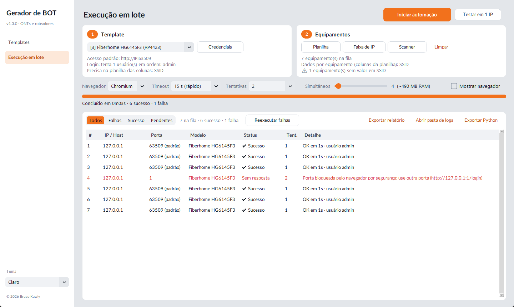

# Gerador de BOT

Automação em lote de ONTs e roteadores pela interface web: você **grava** a configuração uma vez num equipamento de referência e o bot **repete** em centenas de equipamentos (Wi-Fi, PPPoE, VLAN, TR-069, senhas...), com dados diferentes para cada um.

Feito em Python + [Playwright](https://playwright.dev/python/). Roda em **Windows, macOS e Linux**, com interface gráfica ou pela linha de comando.



---

## Início rápido

Requisito: **Python 3.10+**.

| Sistema | Como abrir |
|---|---|
| Windows | dois cliques em `iniciar.bat` |
| macOS / Linux | `./iniciar.sh` |

Na primeira vez o script cria o ambiente (`.venv`), instala as dependências e os navegadores do Playwright. Depois ele só abre o app.

<details>
<summary>Instalação manual / problemas comuns</summary>

```bash
python3 -m venv .venv
source .venv/bin/activate          # Windows: .venv\Scripts\activate
pip install -r requirements.txt
python -m playwright install chromium firefox
python main.py
```

- **Linux sem interface gráfica (tkinter):** `sudo apt install python3-tk` (Debian/Ubuntu) ou `sudo dnf install python3-tkinter` (Fedora).
- **macOS com Python do Homebrew:** `brew install python-tk`. O Python do python.org já vem com tkinter.
- **Linux, libs do navegador:** `python -m playwright install-deps` (precisa de sudo).
- **Servidor (sem tela):** `./install.sh --headless` instala só o motor e o Chromium.
</details>

---

## Como funciona

1. **Template**: a "receita" de um modelo. É gravada pelo botão *Gravar* (abre o navegador e registra seus cliques) ou escrita à mão.
2. **Equipamentos**: vêm de uma planilha, de uma faixa de IPs ou do **Scanner**, que também identifica o modelo.
3. **Executar**: o bot abre **um** navegador e roda vários equipamentos em paralelo (um contexto isolado para cada), repete o que falhou por instabilidade e tira screenshot de toda falha.

### Variáveis

No template, escreva `{{NOME}}` onde entra um valor que muda:

| Variável | O que é |
|---|---|
| `{{BASE_URL}}` | `http://IP:porta` (ou `https://`): use no `page.goto(...)` |
| `{{IP}}`, `{{PORT}}`, `{{SCHEME}}` | partes do endereço |
| `{{USERNAME}}`, `{{PASSWORD}}` | login que está sendo testado (veja *Credenciais*) |
| `{{QUALQUER_COLUNA}}` | qualquer coluna da planilha: `{{SSID}}`, `{{SENHA_WIFI}}`, `{{VLAN}}`... |

O nome da coluna vira variável em maiúsculas e sem acento: `Senha Wi-Fi` → `{{SENHA_WIFI}}`.

**Valores padrão do template** (um `NOME=valor` por linha) definem a porta e o protocolo daquele modelo e valores fixos:

```
PORT=8080
SCHEME=https
PORTA_REMOTA=7547
```

Prioridade: **planilha/scanner > valor padrão do template > automático** (porta 80, ou 443 se `https`).

### Planilha

`.xlsx` ou `.csv` (separador `,` ou `;`). Só a coluna **IP** é obrigatória.

| IP | Porta | Usuário | Senha | SSID | Senha Wi-Fi |
|---|---|---|---|---|---|
| 10.0.0.10 | | | | Loja Centro | 12345678 |
| 10.0.0.11 | 8080 | suporte | s3nh@ | Casa Silva | abcdefgh |

- **Porta** vazia usa a porta padrão do template.
- **Usuário/Senha** na planilha valem só para aquela linha e têm prioridade sobre as credenciais do template.
- **Protocolo** (`http`/`https`) é opcional.

### Credenciais

Cada template tem uma lista `usuario:senha` (uma por linha). O bot tenta **em ordem** até o login funcionar, o que resolve frota com senhas diferentes (padrão de fábrica, senha do provedor...). Login HTTP Basic (janela do navegador) é tratado automaticamente. Para login por formulário, se o modelo não mostra erro claro, o template pode avisar o bot:

```python
if await page.locator("text=Senha incorreta").count():
    raise LoginError("senha incorreta")
```

### Tipos de falha

| Falha | Significa | O bot... |
|---|---|---|
| Sem resposta | IP/porta não responde | repete com espera crescente |
| Tempo esgotado | página/elemento não apareceu | tenta a próxima credencial e depois repete |
| Login recusado | HTTP 401 ou `LoginError` | tenta a próxima credencial |
| Erro na página | elemento mudou, clique falhou | repete |
| Erro no template | erro no código Python | **não** repete; corrija o template |

Dê dois cliques numa falha para abrir o screenshot. Use **Reexecutar falhas** para rodar só o que falhou.

### Scanner de rede

Varre uma faixa de IPs e, **sem fazer login**, tenta identificar fabricante, modelo e firmware por:
página web (título, header `Server`, realm do login), **UPnP**, **SNMP** (`sysDescr`), sondas específicas de fabricante (ex.: Fiberhome) e MAC (tabela ARP, só na mesma rede). Quando o modelo bate com um template cadastrado, ele é sugerido.

> O firmware geralmente só aparece depois do login, então nem sempre é detectado.

---

## Linha de comando (sem interface)

```bash
# executar um template num lote
python -m core run --template-id 3 --devices equipamentos.xlsx --json resultado.json
python -m core run --template-file template.py --devices lista.csv \
       --credentials creds.txt --set PORT=8080 --workers 10 --attempts 3

# scanner
python -m core scan 192.168.1.1 192.168.1.254 --ports 80,443,8080 --json scan.json

# listar templates
python -m core templates
```

Código de saída: `0` tudo OK · `1` algum equipamento falhou · `2` erro de uso/arquivo.
Variáveis de ambiente: `GERADOR_BOT_DB` (banco de templates) e `GERADOR_BOT_LOGS` (pasta de screenshots).

---

## Estrutura

```
core/                  motor, sem interface (reutilizável por outros sistemas)
  automation_engine.py   execução: navegador compartilhado, retry, credenciais, erros
  devices.py             planilha, variáveis, valores padrão, credenciais
  fingerprint.py         scanner e identificação de modelo
  cli.py                 linha de comando (python -m core)
  platform_utils.py      diferenças Windows/macOS/Linux
database/db_handler.py SQLite (templates, credenciais, valores padrão)
gui/                   interface CustomTkinter (visual OLT Cloud)
tests/                 testes com roteador falso local
docs/INTEGRACAO.md     guia para integrar o motor em outro sistema
```

## Testes

```bash
python -m unittest discover -s tests -t . -v
```

Os testes sobem um **roteador falso local** (login por formulário, HTTP Basic, página lenta) e servidores HTTP/SNMP falsos. Nenhum equipamento real é acessado.

## Segurança

- **Templates são código Python** e rodam com as permissões de quem executa. Só importe templates de fontes confiáveis (o app avisa na importação).
- Credenciais ficam **sem criptografia** no banco local (`bot_templates.db`). O *Exportar* pergunta se deve incluí-las.

## Licença

MIT — veja [LICENSE](LICENSE).
